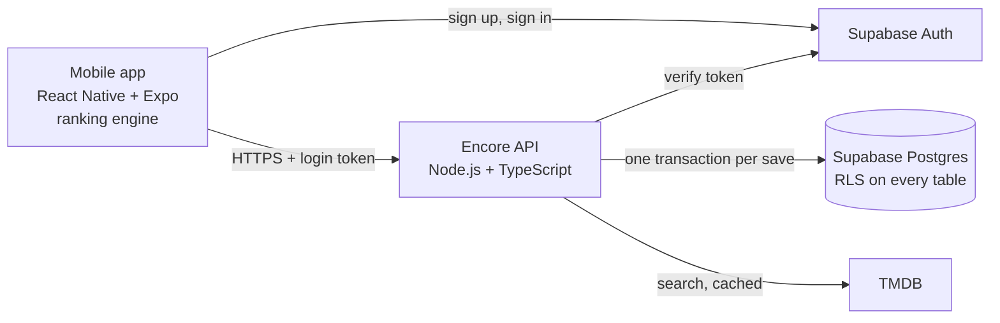

# Encore — living document

Status: CSE 403 project plan. This file mirrors the team's living document; update both together as decisions, experiments, and feedback evolve. Points where the plan is still inconsistent or undecided are collected under [Open questions](#open-questions).

## 1. Team

| Member | GitHub | Area |
| --- | --- | --- |
| Alexander Knotwell | `alexknot` | Backend: shared data model for rankings, reviews, and lists |
| David Tong | `davidtm6` | Accounts, privacy, interface, and accessibility |
| Lucas Mesfin | `lucasm16` | Movie search and data |
| Pavan Chaganti | `pavankc` | Ranking and reviews |
| Nathan Simon | `nsimon06` | Testing, deployment, and user feedback |

Repository: <https://github.com/Davidtm6/Encore>

Coordination happens in iMessage, decisions are recorded in Google Docs, and tasks and reviews are tracked in GitHub issues and pull requests. Course questions go to Ed, following the course discussion rules.

## 2. Product description

Encore is a movie-ranking app for people who want to remember what they watched and understand their preferences. Instead of assigning every film a score, users choose between two movies to build a personal best-to-worst list. Reviews explain those choices; optional social and discovery features can help users find their next movie.

**Problem and alternatives.** Letterboxd and IMDb use a 5-star or 1–10 scale. Scores can leave several films tied even when a viewer prefers one. Encore's focus is a guided comparison flow that makes relative preferences explicit. We will test whether viewers find this useful and easy to use; we do not assume it is unique among existing apps.

**MVP features.**

1. Create an account and sign in.
2. Search movies and mark them watched.
3. Rank and re-rank movies through comparisons.
4. Write and edit one review per watched movie.

Users can view their saved watched list, ranking, and reviews after signing back in.

**Stretch goals.** Accepted friendships with shared reviews and comments; personalized recommendations based on a user's top-ranked movies and what their friends rank highly.

**Approach and scope.** A mobile app for iOS and Android in React Native (TypeScript) with Expo, run in Expo Go during development; a Node.js service for ranking and data access; Supabase for auth and data; TMDB as the movie-data source, with a seeded sample catalog for testing.

**Main challenge.** Comparisons may feel repetitive or fail to reflect changing preferences. Keep each choice simple, allow canceling and re-ranking, and test the flow early with movie viewers.

**Review abuse.** One review per user per movie, editable later. Rate-limit submitted matchups to 100 per user per hour and require a verified email before saving rankings.

## 3. Use cases (functional requirements)

### UC1 — Create an account (David Tong)

- **Actors:** new user; email service.
- **Trigger:** user selects Sign up.
- **Preconditions:** user has an email address and can open the app.
- **Postconditions:** a verified account exists and the user can sign in.
- **Steps:** enter email, username, and password; submit; open the verification email; verify; sign in.
- **Extensions:** an existing user chooses Sign in; resend the verification email.
- **Exceptions:** invalid fields, duplicate email, expired link, or service failure show a clear message and a way to retry.

### UC2 — Find and log a movie (Pavan Chaganti)

- **Actors:** signed-in user; movie-data service.
- **Trigger:** user searches for a movie.
- **Preconditions:** user has a verified account.
- **Postconditions:** the selected movie appears once in the watched list.
- **Steps:** enter a title; inspect title/year matches; select the correct film; choose Mark watched; view the updated list.
- **Extensions:** the movie can remain unranked; an already-watched movie opens its existing record.
- **Exceptions:** no results, invalid search, or an unavailable service shows a useful message without creating a record.

### UC3 — Rank a watched movie (Lucas Mesfin)

- **Actors:** signed-in user.
- **Trigger:** user chooses Rank on an unranked watched movie.
- **Preconditions:** the movie is watched and unranked.
- **Postconditions:** the movie has one position in the saved ranking; existing movies keep their relative order.
- **Steps:** open comparison; choose the preferred film in each pair; finish comparisons; confirm the result; view the saved ranking.
- **Extensions:** the first film becomes number one without comparisons; cancel leaves the ranking unchanged.
- **Exceptions:** a failed save or another session changing the list prompts a retry; no partial ranking is saved.

### UC4 — Re-rank a movie (Nathan Simon)

- **Actors:** signed-in user.
- **Trigger:** user selects Re-rank on a ranked movie.
- **Preconditions:** the user owns the ranking; the movie already has a position.
- **Postconditions:** the movie appears once at its updated position; other movies keep their relative order.
- **Steps:** select the movie; start re-ranking; answer comparisons; confirm; inspect the updated order.
- **Extensions:** cancel preserves the old order; answers may produce the same position.
- **Exceptions:** a failed save or conflicting edits preserve the last valid order and offer a retry.

### UC5 — Write or edit a review (Alex Knotwell)

- **Actors:** signed-in user.
- **Trigger:** user selects Write review or Edit review.
- **Preconditions:** the movie is in the user's watched list.
- **Postconditions:** one review is saved for that user/movie pair.
- **Steps:** open the review form; enter or change text; submit; view the saved review.
- **Extensions:** cancel preserves the existing review; an unranked watched movie can be reviewed.
- **Exceptions:** empty or over-limit text shows validation; failed saves keep the text for retry; editing another user's review is rejected; text that fails the content filter is rejected.

## 4. Non-functional requirements

- **Usability:** at least 4 of 5 first-time testers can find, log, and rank a movie within three minutes without coaching. Check with a timed usability session on a prepared ten-film list.
- **Security and privacy:** users cannot read another user's private watched list or change their ranking or reviews. Verify with two test accounts, including direct requests that bypass the interface. Require a verified email before saving rankings.
- **Data integrity:** canceled or failed ranking operations preserve the previous list; simultaneous edits never create duplicate positions or duplicate reviews. Verify with cancellation, interrupted-save, and concurrent-edit tests.
- **Accessibility:** all MVP actions work with VoiceOver (iOS) and TalkBack (Android), with labeled controls and a logical focus order. Check every MVP use case manually on both platforms and run the iOS Accessibility Inspector and Android Accessibility Scanner for serious errors.

## 5. External requirements

- **Expected errors:** Encore validates account, search, and review input and explains empty results, unavailable services, and save failures. Exercise these conditions before release; failures must not corrupt saved data.
- **Public access:** distribute the app to testers through TestFlight (iOS) and Google Play internal testing (Android). A new tester must be able to install it, create an account, and complete the core movie flow without help from the team.
- **Build and developer documentation:** the repository explains how to run the app and service, create a fresh database, configure required services, load sample movies, and ship a new build. It documents the main components and the contribution process. Someone outside the team follows the instructions on a clean setup.
- **Feasible scope:** assign the four MVP features across the five members and finish them before stretch work. At weekly reviews, defer social or recommendation work if any core use case is incomplete. Update assignments if team size changes.

## 6. Team process

### Tools

| Purpose | Tool |
| --- | --- |
| Mobile app for iOS and Android (one codebase) | React Native + Expo |
| Auth, email verification, database | Supabase (Postgres with row-level security) |
| Builds and tester distribution | EAS Build, TestFlight (iOS), and Google Play internal testing (Android) |
| Source control, tasks, reviews | GitHub issues and reviewed pull requests |
| Automated checks | GitHub Actions running Jest with React Native Testing Library, and Maestro |
| Accessibility checks | iOS Accessibility Inspector and VoiceOver; Android Accessibility Scanner and TalkBack |
| Coordination and decisions | iMessage and Google Docs |

### Roles

Everyone codes, reviews, and tests. Each area has one owner.

- **David — accounts and privacy.** Every feature needs secure sign-in and private data.
- **Alex — backend.** Rankings, reviews, and lists share one data model.
- **Lucas — search and data.** Every flow starts with finding a movie.
- **Pavan — ranking.** Head-to-head ranking is the core feature.
- **Nathan — testing, deployment, and feedback.** Five people merging need CI, a stable deploy, and user testing.

### Subgroups and backups

Subgroups are A (David, Alex), B (Lucas, Pavan), and C (Nathan); each demos weekly. David and Alex back each other up, Lucas and Pavan back each other up, and David backs up Nathan. Decisions are recorded in Google Docs. Disagreements are settled at the weekly meeting, and the area owner makes the final call.

### Process

Weekly planning and demos, a midweek check-in, and one review per PR. No stretch work until the MVP passes.

### Risks

| # | Risk | Likelihood | Impact | Reduction | Detection | Mitigation |
| --- | --- | --- | --- | --- | --- | --- |
| 1 | IMDb data unavailable (the official API is a paid commercial product; TMDB is free for noncommercial use with attribution) | High | Medium | Put all movie lookups behind one search module; use 50 sample films until the provider is confirmed; confirm TMDB terms and rate limits in week 1 | A CI test calls the provider and checks the response format on every run | Switch the search module to TMDB; nothing else changes |
| 2 | Comparison fatigue (binary insertion needs about log₂ n comparisons, roughly 7 for 100 films; not yet tested with users) | Medium | High | One simple question per screen; test the mockup with 3 users in week 2 | Users stalling or quitting in usability sessions; comparisons per ranking tracked in the app | Cap comparisons, add "skip" or "too close to call", and simplify prompts |
| 3 | Private data exposed (Supabase tables are reachable through its public API unless RLS is enabled on every table) | Medium | High | Enable RLS on every table from day one; David reviews policies on each schema PR | A security suite where a second account tries to read and edit the first account's data through direct API requests | Disable the affected endpoint, fix the policy, and add a regression test |
| 4 | Corrupted rankings (two open sessions or a dropped connection could save a partial or outdated order) | Low | High | Each save goes through one Supabase database function that checks the list hasn't changed since it was loaded and writes the whole order at once | Concurrent-session, cancel, interrupted-save, and offline tests in week 5; a check for duplicate positions | Reject the save, keep the last valid order, and prompt the user to retry |
| 5 | Mobile build or distribution blocked (TestFlight needs a paid Apple Developer account and Google Play needs a developer account; no EAS build run yet) | Medium | High | Set up both store accounts and run first EAS builds, a TestFlight upload, and a Play internal-testing upload in week 1; use Expo Go day to day | A CI build fails or a store upload is rejected | Test in Expo Go, the iOS Simulator, and the Android emulator while fixing the build; lend team phones to testers |

**Changes since the requirements document.** That document listed one risk: whether ranking stays consistent for a user with 12 movies versus 100+. We lowered it, because binary insertion works the same way at any list size; only the number of comparisons grows, which risk 2 now covers. Risks 1, 3, 4, and 5 are new, and risk 5 comes from switching to a mobile app.

**External feedback.** Weeks 2, 6, and 8 with 3, 5, and 5 outside users. Measure against the 4-of-5-in-3-minutes target and file the top findings as issues.

### Schedule

| Milestone | Week | Goal |
| --- | --- | --- |
| M1 | 1 | Repo, CI, schema, sample data, first TestFlight and Play internal-testing builds |
| M2 | 2 | Mockup tested with 3 users |
| M3 | 4 | UC1–3 work end to end |
| M4 | 5 | MVP complete |
| M5 | 6 | MVP tested with 5 users |
| M6 | 7 | Fixes done; README verified |
| M7 | 8 | Final release; retest with 5 users |

Tasks are one person-week each unless noted; dependencies follow the semicolon.

| Week | Tasks |
| --- | --- |
| 1 | CI and mobile build setup, and the mockup (Nathan, 0.5 each). Schema design (Alex). Sample films (Lucas). Comparison-screen prototype (Pavan). Sign-up screen (David). |
| 2 | UC1 happy path (David; schema). UC2 on sample data (Lucas; schema, films). Ranking engine (Pavan; prototype). Data layer (Alex; schema). Mockup test (Nathan, 0.5; mockup). |
| 3 | UC1 errors and RLS test (David; UC1). Live provider (Lucas; UC2). UC3 happy path (Pavan; UC2, engine, data layer). Review API (Alex; data layer). E2E tests for UC1–2 (Nathan; UC1, UC2). |
| 4 | UC5 (Alex; review API). UC3 edge cases (Pavan; UC3). UC4 (Lucas; UC3). Verified email and screen-reader support (David; UC1). E2E test for UC3 (Nathan; UC3). |
| 5 | UC5 errors (Alex). Atomic saves (Pavan; UC4). Search errors (Lucas). API bypass tests (David). Concurrency tests (Nathan; atomic saves). |
| 6 | 5-user test (Nathan; M4). Bug fixes (everyone else; M4). |
| 7 | Feedback fixes (everyone else; week 6 test). README and outsider setup test (Nathan; M4). |
| 8 | 5-user retest (Nathan; week 7 fixes). Final fixes and release (everyone else). |

### Test plan and bugs

Every MVP use case (UC1–5), including its exceptions, and every non-functional requirement maps to at least one suite below.

- **Unit tests (Jest):** the ranking engine (insertion, cancel, first movie, no duplicates) and input validation. Run on every PR; a failing test blocks the merge.
- **System tests (Maestro on the iOS Simulator and Android emulator), run before each tester release:**
  - Use cases: one happy-path and one exception test per use case.
  - Security: a second account tries to access the first account's data.
  - Data integrity: cancel, interrupted save, and simultaneous sessions.
  - Accessibility: a VoiceOver and TalkBack pass on every MVP flow.
- **Usability tests:** 3, 5, and 5 outside users in weeks 2, 6, and 8. Target: 4 of 5 rank a movie within 3 minutes without help.

Every bug is filed in GitHub Issues with reproduction steps and labels for severity and use case. Bugs are triaged weekly, and each fix gets a regression test.

### Documentation plan

| Document | Audience | Contents | Owner, due |
| --- | --- | --- | --- |
| In-app help | Users | First-run tips for adding and ranking a movie; a short FAQ explaining common errors | David, week 7 |
| README | Developers | Installing Expo, running the app in the iOS Simulator and Android emulator, setting up Supabase, loading sample movies, shipping TestFlight and Play builds; verified by someone outside the team on a clean machine | Nathan, week 7 |
| Architecture notes | Developers | Main components, the data model, and RLS policies | Alex, week 6 |
| Contributing guide | Team | Branch naming, PR review rules, and how to file bugs | Nathan, week 2 |
| Admin notes | Maintainers | Managing Supabase, rotating API keys, handling movie-provider limits | Lucas, week 7 |

Any PR that changes setup or behavior also updates the relevant doc.

## 7. Software architecture

### 7.1 Major components

- **Mobile app (React Native + Expo, iOS and Android):** sign up and sign in, movie search, the watched list, ranking by picking between two movies, and reviews.
- **Ranking engine (TypeScript, runs inside the app):** chooses the next pair to show, records each pick, and works out the movie's final position. Running on the phone keeps every tap instant. The server runs the same code to check the result.
- **Authentication (Supabase Auth):** sign up, email verification, sign in, password reset, and login tokens. Encore never stores or sees passwords.
- **Encore API (Node.js + TypeScript):** our own server. The app sends every data request here. It checks who the user is, validates input, saves rankings and reviews, and fetches movie data from TMDB.
- **Database (Supabase Postgres):** profiles, movies, watched lists, rankings, and reviews. Only the Encore API reads or writes it; RLS stays enabled on every table as a second line of defense.
- **Movie data (TMDB):** titles, years, posters, and descriptions.
- **CI/CD (GitHub Actions):** runs tests on every pull request.

### 7.2 Interactions

- **App → Supabase Auth:** sign up with email, password, and username; Supabase sends the confirmation email.
- **App → Encore API:** HTTPS requests with the login token attached.
- **Encore API → Supabase Auth:** verifies each token and identifies the user. That user ID scopes every database query, so people can only see and change their own data.
- **Encore API → Database:** saving a ranking happens in one transaction, so it either fully saves or changes nothing.
- **Encore API → TMDB:** movie search results.

### 7.3 Data storage

All data is stored in Supabase.

| Table | Stores |
| --- | --- |
| `profiles` | Username, display name, and other profile details |
| `movies` | Title, year, genre, provider link, and poster |
| `watched_movies` | Which movies each user has watched |
| `reviews` | Review text and timestamps; one per user/movie pair |
| `rankings` | A record of each saved ranking |

The draft migration in `supabase/migrations/` implements `profiles`, `movies`, `watched_movies` (which currently also holds each movie's rank position), and `reviews`. Genre, display name, a separate rankings table, matchup rate limits, and the atomic save function are not in it yet.

### 7.4 Assumptions

- Mobile only (iOS and Android); no web version for now.
- Free tiers of Supabase, Expo/EAS, and TMDB are enough.
- We don't build our own login.
- The movie catalog we cache isn't huge.

### 7.5 Architecture decisions

- Build our own API and backend instead of calling Supabase directly from the app.
- Run the ranking engine in the app for instant feedback, and re-check results on the server before saving.

## 8. Software design

The repository will have three top-level folders: `app/` (Expo app), `server/` (Encore API and ranking), and `supabase/` (database and movie search). In the app, screens call hooks and hooks call services. There is one screen per use case area: sign in and sign up, my movies, and reviews.

- **Components (`app/components`):** a few shared display components (`MovieCard`, `ComparisonPair`, `RankedList`, `ErrorBanner`) that render data and collect input.
- **Hooks (`app/hooks`):** one per screen (`useSession`, `useMovieSearch`, `useMyMovies`, `useRanking`, `useReview`). Each holds the screen's state, calls services, and handles loading, errors, and retries.
- **Services (`app/services`):** one typed client per backend resource (`authService`, `movieService`, `watchedService`, `reviewService`, `rankingApi`), sharing types generated from the database schema.
- **Ranking service (`server/src`):** decides where each movie goes in a user's list. It first checks who is making the request and that the request makes sense. `RankingService` runs the comparison exchange and saves the final position; `RankingSession` picks the next pair and where the new movie belongs; `RankingRepository` reads and saves rankings.
- **Supabase (`supabase/`):** migrations create the tables and the rules for who can see what. A `searchMovies` function looks up movies on TMDB for the app and caches the results.

### Ranking algorithm

Maintain a best-to-worst list. To add a movie, compare it with the middle movie of the remaining interval. If the user prefers the new movie, search the better half; otherwise search the worse half. Insert when one position remains. For `n` ranked movies this takes at most `ceil(log2(n + 1))` comparisons: up to 4 for 12 movies and up to 7 for 100; an empty list needs none. Canceling leaves the stored ranking unchanged. Re-ranking removes the movie from its position and repeats insertion into the remaining list.

The Python prototype in `prototype/` explores this algorithm and tests every insertion position for list sizes 0 through 128. It is a reference for the TypeScript engine, not application code.

## 9. Coding guidelines

- **TypeScript:** [Google TypeScript Style Guide](https://google.github.io/styleguide/tsguide.html), chosen because it is written for TypeScript and has clear rules that make review easier. Enforced with Google's `gts` package (ESLint, typescript-eslint, and Prettier).
- **React and JSX:** [Airbnb React/JSX Style Guide](https://airbnb.io/javascript/react/) for component naming, JSX formatting, props, and list keys. Skip its rules for class components, `.jsx` files, and PropTypes, since we use function components and TypeScript. Enforced by adding `eslint-plugin-react` and `eslint-plugin-react-hooks` on top of `gts`. Where the two guides conflict, such as default exports, follow Google's guide.

## Open questions

These are places where the team document disagrees with itself or leaves a choice open. Resolve them in Google Docs and update this section.

- **API framework.** Sections 2 and 8 say Express; section 7 says Fastify.
- **Ranking model.** Sections 7.3 and 7.5 mention Elo and assume no re-ranking, but UC4 makes re-ranking an MVP feature and the risks, tests, and schedule all assume binary insertion into an ordered list. This file assumes binary insertion.
- **Where the atomic save lives.** Risk 4 describes a Supabase database function; section 7.2 describes an API transaction. Both can hold if the API calls one database function that checks a list version and rewrites the order.
- **Offline ranking.** Section 7.4 assumes rankings work offline, but saves go through the API. Decide whether offline means queued saves or comparisons only.
- **Ties and skips.** Risk 2's mitigation adds "skip" or "too close to call", which the strict ordering does not yet support.
- **Web leftovers.** The team document's accessibility and public-access requirements (sections 4 and 5) still mention keyboard use and deploying a web app. This file rewrites them for mobile (VoiceOver and TalkBack, TestFlight and Google Play).
- **iOS-only wording.** The team document says iOS throughout (TestFlight, VoiceOver, iOS Simulator). This file says iOS and Android, since Expo builds both; the team document should be updated to match, and the team needs a Google Play developer account and an Android test device.
- **Public versus friends-only reviews.** The draft migration lets any signed-in user read reviews; decide before the social stretch goals.
